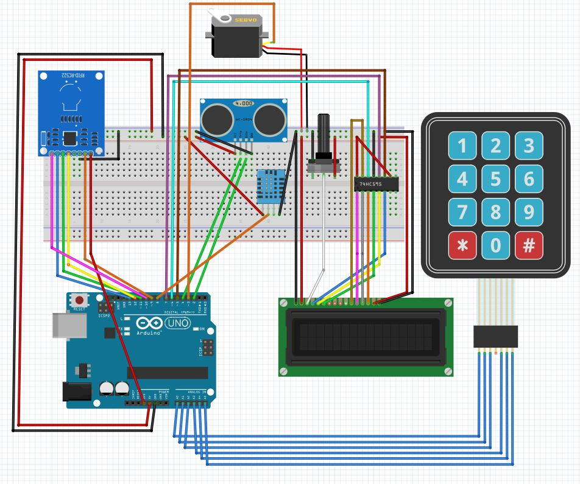

# Arduino COVID-19 Access Control

An Arduino-based entry gate that lets a person in only after three independent checks pass: **identity**, **proximity** and **body temperature**. It was built as an embedded-systems course project (2020) to demonstrate sensor/actuator integration on a resource-constrained board.



## How it works

```
 ┌─ RFID card ─┐
 │             ├─► identity ─► proximity (≤ 6 cm) ─► temperature (< 37.5 °C) ─► servo opens
 └─ 4-digit PIN┘      │                                      │
                      ▼                                      ▼
                 denied / retry                      "fever detected" – entry refused
```

1. **Identity** – choose `1` (RFID) or `2` (PIN) on the keypad.
   - *RFID*: the card UID must be present in the EEPROM whitelist.
   - *PIN*: after a correct PIN the user may also **enrol a new RFID card**.
2. **Proximity** – an HC-SR04 ultrasonic sensor makes sure the user stands within 6 cm of the temperature sensor.
3. **Temperature** – a DHT11 reading below 37.5 °C is required. The MLX90614 contactless sensor is the recommended part; the DHT11 is a stand-in because of the component shortage at the time. If the sensor cannot be read, access is denied (fail-closed).
4. **Actuation** – a servo rotates 90° for 5 s to simulate the door lock.

Messages on the 16×2 LCD are in Italian.

## Hardware

| Component | Role | Arduino pin |
|---|---|---|
| MFRC522 RFID reader | card identification | SS 10, RST 9, SPI (11/12/13) |
| 16×2 LCD + IC4094 shift register | UI | data 6, clock 5, strobe 7 |
| 3×3 keypad | menu / PIN entry | rows A5, A4, A3 · columns A2, A1, A0 |
| HC-SR04 | distance | trig 4, echo 2 |
| DHT11 | temperature | 8 |
| Servo | lock simulation | 3 |

## Build

Install these libraries from the Arduino Library Manager: `MFRC522`, `Keypad`, `LiquidCrystal_SR3W` (via the NewLiquidCrystal fork), `SR04`, `DHT_nonblocking`. Then open [firmware/AccessControl/AccessControl.ino](firmware/AccessControl/AccessControl.ino), pick *Arduino Uno* and upload.

Tunable parameters (PIN, fever threshold, proximity distance, timings) are constants at the top of the sketch. **Change the default PIN `1234` before any real use.**

> The refactored sketch has not been compiled on hardware after the 2026 clean-up; the original logic is preserved.

## Notes and limitations

- Cards are stored as the first 4 bytes of their UID (8 hex characters) in EEPROM: up to 56 cards on an ATmega328P. UIDs are not secret and can be cloned, so RFID here is a convenience, not strong authentication.
- The PIN is stored in plain text in the firmware.
- The DHT11 measures ambient temperature and humidity, not body temperature; it only demonstrates the control flow.

## Repository layout

```
firmware/AccessControl/   Arduino sketch
docs/                     project report (PDF) and prototype photo
```

Full report: [docs/Arduino-Access-Control-report.pdf](docs/Arduino-Access-Control-report.pdf).

## Author

Luca D'Agati
